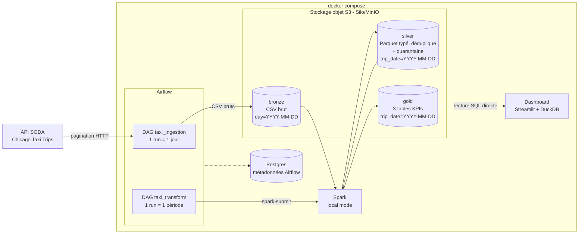

# Chicago Taxi Trips – pipeline datalake de bout en bout

Pipeline de données **orchestré, reproductible et exécutable en local** qui :

1. **ingère** les trajets de taxi de Chicago (API SODA) dans un datalake objet (couche **bronze**) ;
2. les **nettoie et les type** avec Spark (couche **silver**), en isolant les lignes invalides en quarantaine ;
3. calcule des **tables analytiques** prêtes pour la BI (couche **gold**) : revenus par jour, durée des trajets, top des zones de prise en charge ;
4. les **expose** dans un dashboard et via du SQL.

**Stack** : Airflow 3 · PySpark 3.5 · MinIO-compatible (Silo) · Docker Compose · DuckDB · Streamlit

---

## Sommaire

1. [Démarrage rapide](#1-démarrage-rapide)
2. [Architecture](#2-architecture)
3. [Données et reproductibilité](#3-données-et-reproductibilité)
4. [Détail des couches](#4-détail-des-couches)
5. [Choix techniques et arbitrages](#5-choix-techniques-et-arbitrages)
6. [Organisation du code](#6-organisation-du-code)
7. [Ce que j'aurais fait avec plus de temps](#7-ce-que-jaurais-fait-avec-plus-de-temps)

---

## 1. Démarrage rapide

### Prérequis

- **Git**
- **Docker Desktop** (ou Docker Engine + Compose v2)
- **6 Go de RAM minimum alloués à Docker** (8 Go recommandés). Un seul job Spark tourne à la fois : le projet tient sur un PC de 8 Go.
- Un accès internet (API de la ville de Chicago, téléchargement des images au premier lancement)

### Lancement pas à pas


Toutes les commandes suivantes se lancent depuis ce dossier, à la racine du projet (là où se trouve `docker-compose.yml`).

**1. Démarrer la plateforme**

```bash
docker compose up --build
```

Le premier build prend quelques minutes (Java, PySpark, jars S3). Laisser ce terminal ouvert : les logs s'y affichent en direct (`Ctrl+C` pour tout arrêter).
Au démarrage, les buckets `bronze`, `silver` et `gold` sont créés automatiquement.

| Service | URL | Identifiants |
|---|---|---|
| Airflow | http://localhost:8080 | aucun (mode local) |
| Stockage objet (console) | http://localhost:9001 | `minioadmin` / `minioadmin` |
| Dashboard BI | http://localhost:8501 | – |

**2. Ingestion : chargement de la période dans le bronze**

Dans Airflow (http://localhost:8080) :
1. ouvrir le DAG **`taxi_ingestion`** ;
2. cliquer sur **Trigger**, puis choisir l'onglet **Backfill** ;
3. renseigner la période : du **2022-07-01** à minuit au **2022-09-30** à 23h59 ;
4. lancer.

→ 92 runs (un par jour), 3 en parallèle.

**3. Transformation : silver puis gold**

Une fois tous les runs de `taxi_ingestion` au vert, ouvrir le DAG **`taxi_transform`** :
1. cliquer sur **Trigger** (run unique, *Single Run*) ;
2. renseigner `start_date` = **2022-07-01** et `end_date` = **2022-09-30** ;
3. lancer.

→ **1 seul run** pour tout le trimestre : `silver_transform` puis `gold_aggregates`, chacun dans une seule session Spark qui enchaîne les 92 jours.

> Vérifier dans les logs de `silver_transform` que les dates reçues sont bien `--start 2022-07-01 --end 2022-09-30` : selon le fuseau horaire du navigateur, le sélecteur de date peut décaler d'un jour. Dans ce cas, relancer en saisissant les dates à nouveau.


**4. Consulter les résultats**

Ouvrir le dashboard : http://localhost:8501 (KPIs, revenus par jour, durée par heure, top zones, requête SQL libre).

### Où voir les données

**Dans la console du stockage objet** (http://localhost:9001, `minioadmin` / `minioadmin`), chaque couche est un bucket, avec un dossier par jour :

| Couche | Emplacement | Contenu |
|---|---|---|
| Bronze | `bronze/taxi_trips/day=2022-07-01/` | CSV bruts de l'API (`page_0001.csv`…) et `_manifest.json` |
| Silver | `silver/taxi_trips/trip_date=2022-07-01/` | trajets nettoyés, un fichier Parquet par jour |
| Quarantaine | `silver/taxi_trips_quarantine/trip_date=2022-07-01/` | lignes rejetées, avec la colonne `rejection_reason` |
| Gold | `gold/daily_revenue/`, `gold/trip_duration_stats/`, `gold/pickup_zones_daily/` | tables KPIs, un dossier `trip_date=…` par jour |

Les fichiers peuvent être téléchargés depuis la console (bouton **Download**) puis ouverts, par exemple, avec l'extension VS Code *Parquet Viewer* ou *Data Wrangler*.

**Dans le dashboard** (http://localhost:8501), la zone **Requête SQL libre sur le gold** permet d'interroger les tables gold en SQL, par exemple :

```sql
SELECT * FROM pickup_zones_daily WHERE pickup_rank <= 3 ORDER BY trip_date, pickup_rank;
SELECT count(*) AS nb_jours, sum(nb_trips) AS trajets, sum(total_revenue) AS ca FROM daily_revenue;
```

**Dans Airflow** (http://localhost:8080), les logs de chaque tâche indiquent les volumes traités :
- `ingest_bronze` : `Jour 2022-07-01 terminé : 19188 lignes, 1 pages` ;
- `silver_transform` : `[silver] 2022-07-01 : … lignes bronze -> … valides, … en quarantaine, … doublons supprimés` ;
- `gold_aggregates` : `[gold] 2022-07-01 : daily_revenue, trip_duration_stats, pickup_zones_daily écrites`.

### Durées indicatives (PC portable, 8 Go alloués à Docker)

| Étape | Durée observée |
|---|---|
| Ingestion du trimestre (92 jours) | ~25 min sans jeton API (plus rapide avec `SODA_APP_TOKEN`) |
| Transformation du trimestre (silver + gold) | quelques minutes |

### Configuration optionnelle (fichier `.env` à la racine)

Toutes les variables ont une valeur par défaut : le `.env` n'est **pas** nécessaire.

| Variable | Défaut | Rôle |
|---|---|---|
| `SODA_APP_TOKEN` | vide | Jeton gratuit de l'API Chicago : évite le throttling et accélère l'ingestion |
| `PIPELINE_START_DATE` | `2013-01-01` | Premier jour accepté par les backfills (premier trajet du dataset) |
| `SODA_DATASET_ID` | `wrvz-psew` | Dataset source (`ajtu-isnz` pour les trajets 2024+) |
| `SODA_MAX_ROWS_PER_DAY` | `0` (illimité) | Plafond de lignes par jour, pour un test rapide |
| `SPARK_DRIVER_MEMORY` | `1g` | Mémoire du job Spark |

### Fonctionnement quotidien (production)

En plus du chargement historique, `taxi_ingestion` est **planifié chaque jour à 8 h (heure de Paris)** :

```
8h00  taxi_ingestion   ingère la VEILLE (journée complète) dans le bronze
        └── déclenche automatiquement taxi_transform sur ce seul jour (silver puis gold)
```

- La transformation n'est déclenchée que pour les **runs planifiés** : en backfill, on évite ainsi un job Spark par jour, et la transformation se lance une seule fois sur toute la période (étape 3).
- Le dataset de l'énoncé (`wrvz-psew`) s'arrête au 2023-12-31 : les runs quotidiens sont donc marqués *skipped* par `check_source_has_data`, sans erreur. Pour un flux réel, utiliser `SODA_DATASET_ID=ajtu-isnz` (trajets 2024+).
- Au démarrage de la plateforme, Airflow peut créer le run de la veille : il est lui aussi *skipped* s'il n'y a pas de données.

### Rejouer ou retraiter

- **Rejouer un jour d'ingestion** : DAG `taxi_ingestion` → cliquer sur la tâche du jour → **Clear Task Instance**. La partition bronze du jour est réécrite, sans doublon.
- **Retraiter quelques jours** : DAG `taxi_transform` → **Trigger** avec `start_date` / `end_date` sur la période voulue. Seuls ces jours sont réécrits en silver et en gold.

### Arrêter

- `Ctrl+C` dans le terminal de `docker compose up`, puis `docker compose down` : arrêt, **données conservées**.
- `docker compose down -v` : arrêt et **suppression de toutes les données** (datalake et historique Airflow).

---

## 2. Architecture



**Deux DAGs, deux découpages**, chacun adapté à ce qui le ralentit :

| | `taxi_ingestion` | `taxi_transform` |
|---|---|---|
| Contrainte | API lente sur les grosses requêtes | Démarrage de Spark (~30 s) coûteux |
| Découpage | **1 run = 1 jour** (requêtes courtes) | **1 run = la période choisie** (`start_date` / `end_date`) |
| Tâches | `check_source_has_data` → `ingest_bronze` → `is_daily_run` → `trigger_transform` | `silver_transform` → `gold_aggregates` |
| Planification | **chaque jour à 8 h** (Europe/Paris), ingestion de la veille | aucune : déclenché par l'ingestion quotidienne, ou à la main |

Dans les trois couches, le **stockage est partitionné par jour**.

---

## 3. Données et reproductibilité

- **Source** : [Taxi Trips (2013-2023)](https://data.cityofchicago.org/Transportation/Taxi-Trips-2013-2023-/wrvz-psew), dataset `wrvz-psew`, via l'API SODA. Il couvre les trajets du **2013-01-01 00:00** au **2023-12-31 23:45** (`min` / `max` de `trip_start_timestamp`) : n'importe quelle période de cet intervalle peut être chargée en backfill.
- **Période retenue** : **T3 2022, du 1er juillet au 30 septembre 2022** (92 jours, de l'ordre de 20 000 trajets par jour).
- **Requête** : pour chaque jour, filtre `trip_start_timestamp >= 'J' AND trip_start_timestamp < 'J+1'`, tri stable `$order=:id`, pagination par `$limit` / `$offset` (pages de 20 000 lignes).
- **Script** : [`dags/taxi/ingestion.py`](dags/taxi/ingestion.py), lancé par le DAG `taxi_ingestion` (backfill sur la période, cf. démarrage rapide).

Chaque partition bronze contient un `_manifest.json` (requête exacte, nombre de lignes et de pages, date d'ingestion), qui assure la traçabilité de ce qui a été téléchargé.

---

## 4. Détail des couches

### Bronze : données brutes

`s3://bronze/taxi_trips/day=YYYY-MM-DD/page_NNNN.csv` + `_manifest.json`

- CSV **tels que renvoyés par l'API**, non modifiés, une page = un fichier.
- `check_source_has_data` compte les trajets publiés pour le jour (côté API, sans téléchargement) : s'il n'y en a aucun, le run est marqué *skipped* et non en échec.
- Rejouer un jour **supprime d'abord sa partition**, puis la réécrit : ingestion **idempotente**.
- Robustesse HTTP : timeout de 300 s, 5 réessais par page avec attente exponentielle (y compris sur les erreurs 429 de throttling).

### Silver : données nettoyées

`s3://silver/taxi_trips/trip_date=YYYY-MM-DD/` et `s3://silver/taxi_trips_quarantine/trip_date=YYYY-MM-DD/`

1. Lecture du CSV **par nom de colonne**, tout en texte, puis **typage explicite** (timestamps, décimaux pour les montants, entiers…).
2. **Règles qualité** : chaque ligne invalide reçoit une `rejection_reason` et part en **quarantaine** (rien n'est supprimé silencieusement) :
   `missing_trip_id`, `missing_start_timestamp`, `end_before_start`, `invalid_duration`, `duration_over_24h`, `negative_distance`, `invalid_fare`, `invalid_total`.
3. **Déduplication** sur `trip_id`.
4. Colonnes dérivées pour le gold : `trip_date`, `trip_hour`, `trip_minutes`.
5. **Un fichier Parquet par jour**, écrit en écrasant le dossier du jour : job **idempotent**.

### Gold : tables analytiques

`s3://gold/<table>/trip_date=YYYY-MM-DD/`

| Table | KPI | Contenu |
|---|---|---|
| `daily_revenue` | revenus par jour | nb de trajets, CA, pourboires, panier moyen, taux de pourboire, taxis actifs |
| `trip_duration_stats` | durée des trajets | durée moyenne et médiane, distance moyenne, **par heure** |
| `pickup_zones_daily` | top zones de prise en charge | prises en charge et CA par zone, **nom du quartier**, rang du jour |

Le nom des quartiers provient d'une **jointure** avec le référentiel des 77 *community areas* de Chicago ([`jobs/seeds/community_areas.csv`](jobs/seeds/community_areas.csv)), en *broadcast join* (table minuscule).

### Exposition

- **Dashboard Streamlit** (http://localhost:8501) : 4 KPIs, revenus par jour, durée moyenne par heure, top 10 des zones, filtre de période.
- **SQL** : DuckDB lit **directement** les Parquet du gold dans le stockage objet et expose une vue par table. Une zone de requête SQL libre est disponible dans le dashboard.

---

## 5. Choix techniques et arbitrages

**Orchestration : Airflow 3**
- `standalone` + `LocalExecutor` dans un seul conteneur : simple et suffisant en local (pas de Celery ni de Redis).
- **Postgres** sert uniquement de base de métadonnées à Airflow (état des DAGs, runs, tâches) ; les données métier sont dans le stockage objet. SQLite aurait empêché l'exécution parallèle des tâches.
- Connexions et configuration passées par **variables d'environnement** : aucune action manuelle dans l'interface.
- **Backfill plutôt que catchup automatique** : le chargement de l'historique est un acte explicite ; le planning quotidien ne traite que la veille.
- **Planning à intervalles** (`CronDataIntervalTimetable`, 8 h Europe/Paris) : le run de J+1 à 8 h couvre la journée J, dont les données sont complètes. La même règle s'applique en backfill : un backfill du 2022-07-01 au 2022-09-30 ingère exactement ces jours.
- **Enchaînement ingestion → transformation** par `TriggerDagRunOperator`, uniquement pour les runs planifiés : un nouveau jour est disponible en gold quelques minutes après 8 h.

**Découpage : ingestion par jour, transformation par période**
- L'API SODA est lente et coupe les grosses requêtes : interroger un mois entier provoquait des timeouts. Par jour, chaque requête tient en une ou deux pages et répond en quelques secondes.
- Spark met ~30 s à démarrer, pour quelques secondes de calcul par jour. Une première version lançait un job Spark par jour (~1 h pour le silver du trimestre) ; la version actuelle traite **toute une période dans une seule session Spark**, ce qui a rendu la transformation beaucoup plus rapide.
- Le **stockage reste partitionné par jour** partout : rejouer un jour ne touche que son dossier.

**Spark en mode local**
- PySpark tourne dans le conteneur Airflow (`spark-submit --master local[*]`) : aucun cluster à maintenir, aucun problème de versions entre driver et workers.
- Réglages adaptés aux petits volumes journaliers : `spark.sql.shuffle.partitions=4` (200 par défaut) et `coalesce(1)` à l'écriture (sinon des dizaines de micro-fichiers par jour).
- Un seul job Spark à la fois, avec 1 Go de mémoire : le projet tient sur un poste de 8 Go.

**Stockage objet : Silo (fork de MinIO), image épinglée**
- Compatible S3 : le code est le même que sur un vrai cloud (`s3a://`).
- MinIO a retiré ses images Docker publiques pendant le développement (`minio/minio` et `minio/mc` introuvables). Le projet utilise donc **Silo**, un fork maintenu, avec une **version épinglée** plutôt que `latest`, pour que le projet reste reproductible.

**Formats**
- Bronze en **CSV brut** (fidèle à la source), silver et gold en **Parquet** (colonnaire, typé, compressé).
- Partitionnement au format Hive (`trip_date=…`) : Spark et DuckDB reconstruisent la colonne et ne lisent que les partitions utiles (*partition pruning*).
- Parquet plutôt que Delta Lake : un jar de moins et pas de conflit de versions, l'idempotence étant assurée par la réécriture des partitions.

**Qualité**
- **Quarantaine** avec motif de rejet plutôt que suppression : traçabilité, suivi de la qualité de la source et possibilité de corriger une règle puis de rejouer.
- Échec explicite si un jour n'a aucune ligne valide ou si une partition attendue est absente, plutôt qu'un succès vide.

**Exposition : DuckDB + Streamlit**
- DuckDB lit le gold sur place, sans base à alimenter ; Streamlit fournit un dashboard en quelques dizaines de lignes. Superset ou Metabase auraient été plus lourds à intégrer.

---

## 6. Organisation du code

```
.
├── docker-compose.yml          # toute la plateforme (Postgres, stockage S3, Airflow, dashboard)
├── docker/airflow.Dockerfile   # Airflow + Java 17 + PySpark + jars S3A
├── requirements.txt
├── dags/
│   ├── taxi_ingestion.py       # DAG 1 : API -> bronze, chaque jour à 8h (la veille)
│   ├── taxi_transform.py       # DAG 2 : bronze -> silver -> gold, sur une période
│   ├── hello_spark_minio.py    # smoke test de l'infrastructure (Spark -> stockage)
│   └── taxi/ingestion.py       # logique d'ingestion (pagination, idempotence, manifest)
├── jobs/                       # jobs Spark, indépendants d'Airflow
│   ├── common.py               # SparkSession S3, parsing des dates à traiter
│   ├── silver_trips.py         # typage, règles qualité, quarantaine, dédup
│   ├── gold_aggregates.py      # 3 tables KPIs + jointure référentiel
│   ├── show_table.py           # outil d'exploration d'une table Parquet
│   └── seeds/community_areas.csv
└── dashboard/                  # Streamlit + DuckDB
```

Les DAGs ne font qu'orchestrer ; la logique vit dans des modules Python et des jobs Spark exécutables seuls avec `spark-submit` (`--day 2022-07-15`, ou `--start` / `--end`).

---

## 7. Ce que j'aurais fait avec plus de temps

**Qualité et tests**
- Tests unitaires `pytest` des transformations silver et gold sur de petits DataFrames, et test d'intégrité des DAGs (`DagBag`), exécutés en **CI** (GitHub Actions, avec `ruff`).
- Règles qualité supplémentaires sur les valeurs aberrantes (montants, distances, vitesses impossibles, `trip_total < fare`), et traçage des doublons en quarantaine.
- Contrôles automatisés entre couches (Great Expectations / Soda) : complétude bronze vs source, volumétrie silver vs bronze, alerte si le taux de quarantaine dérive.

**Production**
- Déclenchement de la transformation par *data-aware scheduling* (Assets Airflow) plutôt que par `TriggerDagRunOperator`, et alerting (Slack / e-mail) en cas d'échec ou de jour sans données.
- Cible GCP : **GCS** à la place du stockage local, **Dataproc Serverless** pour Spark (`DataprocCreateBatchOperator`), **Cloud Composer** pour Airflow, tables **BigLake / BigQuery** sur le gold pour la BI, infrastructure en **Terraform**.
- Format de table **Delta Lake ou Iceberg** (MERGE, time travel, évolution de schéma) et un catalogue (Dataplex, Iceberg REST).
- Référentiel des zones géré comme une table du datalake, avec son propre pipeline.
- Secrets dans un gestionnaire dédié (Secret Manager) au lieu de variables en clair.

**Performance**
- Spark sur cluster ou serverless pour paralléliser les périodes ; la limite actuelle est la RAM d'un poste local.
- Ingestion parallèle plus agressive avec un jeton API, et fusion du comptage de contrôle dans l'ingestion pendant les backfills.
